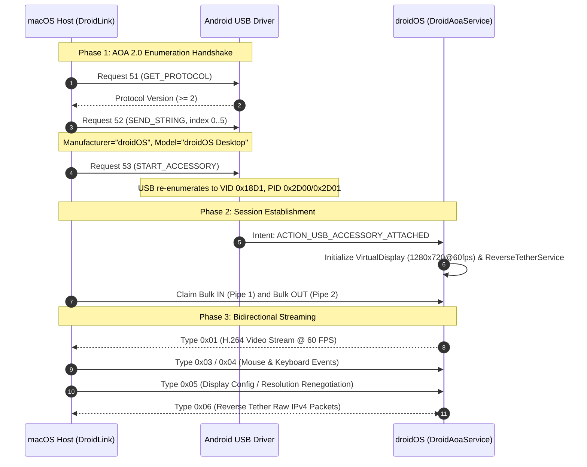

# droidOS Wire Protocol API & ABI Specification
**Document Version:** 1.0  
**Transport:** Android Open Accessory (AOA 2.0) over USB Bulk Transfer  
**Status:** Canonical Implementation Reference for Host Companion Clients (macOS / DroidLink)

---

## 1. Overview & Connection Architecture

The droidOS host-device communication pipeline operates over standard USB without requiring ADB, root daemon authorization, or Wi-Fi pairing.



---

## 2. AOA 2.0 Enumeration Handshake Endpoints

### 2.1 Control Transfers on Endpoint 0

Before bulk streaming begins, the host issues three USB standard control transfers:

#### 1. Request 51: `GET_PROTOCOL`
Queries if the connected USB device supports the Android Open Accessory protocol.
- `bmRequestType`: `0xC0` (Device-to-Host, Vendor, Device)
- `bRequest`: `51`
- `wValue`: `0`
- `wIndex`: `0`
- `wLength`: `2`
- **Response:** 2-byte integer (`uint16_t` Little-Endian). Must be `>= 1` (AOA 2.0 returns `2`).

#### 2. Request 52: `SEND_STRING`
Sends identification strings sequentially to the Android device.
- `bmRequestType`: `0x40` (Host-to-Device, Vendor, Device)
- `bRequest`: `52`
- `wValue`: `0`
- `wIndex`: String Index (`0` to `5`)
- `wLength`: Length of string buffer including null-terminator.

##### Required String Table for droidOS
To automatically trigger the `DroidAoaService` intent filter on the phone, the host **must** send the exact strings below:

| Index | Field | Expected String Value | Purpose |
| :---: | :--- | :--- | :--- |
| `0` | **Manufacturer** | `"droidOS"` | Matches `res/xml/accessory_filter.xml` |
| `1` | **Model** | `"droidOS Desktop"` | Auto-launches `AoaAccessoryService` |
| `2` | **Description** | `"droidOS Workstation Bridge"` | Display name shown in Android notifications |
| `3` | **Version** | `"1.0"` | Accessory protocol version |
| `4` | **URI** | `"https://github.com/droidOS"` | Project URL |
| `5` | **Serial** | `"0000000012345678"` | Unique host session identifier |

#### 3. Request 53: `START_ACCESSORY`
Instructs the device to disconnect its standard USB profile and re-enumerate as an AOA accessory.
- `bmRequestType`: `0x40`
- `bRequest`: `53`
- `wValue`: `0`
- `wIndex`: `0`
- `wLength`: `0`
- `pData`: `NULL`

### 2.2 Post-Handshake USB Descriptors
Following Request 53, the phone disconnects and reappears on the USB bus with:
- **Vendor ID (VID):** `0x18D1` (Google Inc.)
- **Product ID (PID):**
  - `0x2D00`: AOA Accessory Mode only
  - `0x2D01`: AOA Accessory Mode + ADB enabled
- **Interface Class:** `0xFF` (Vendor Specific)
- **Endpoints:**
  - `Bulk IN` (Direction: Device &rarr; Host): Delivers Video (`0x01`) and Outbound Network traffic (`0x06`).
  - `Bulk OUT` (Direction: Host &rarr; Device): Accepts Input events (`0x03`, `0x04`), Config (`0x05`), and Inbound Network traffic (`0x06`).

---

## 3. Wire Protocol Header (8 Bytes)

Every packet exchanged over the Bulk endpoints begins with a fixed **8-byte header**:

```
 0                   1                   2                   3
 0 1 2 3 4 5 6 7 8 9 0 1 2 3 4 5 6 7 8 9 0 1 2 3 4 5 6 7 8 9 0 1
+-+-+-+-+-+-+-+-+-+-+-+-+-+-+-+-+-+-+-+-+-+-+-+-+-+-+-+-+-+-+-+-+
|       'D'     |       'O'     |      Type     |     Flags     |
+-+-+-+-+-+-+-+-+-+-+-+-+-+-+-+-+-+-+-+-+-+-+-+-+-+-+-+-+-+-+-+-+
|                       Length (32-bit BE)                      |
+-+-+-+-+-+-+-+-+-+-+-+-+-+-+-+-+-+-+-+-+-+-+-+-+-+-+-+-+-+-+-+-+
|                       Payload (0 .. Length bytes)             |
+-+-+-+-+-+-+-+-+-+-+-+-+-+-+-+-+-+-+-+-+-+-+-+-+-+-+-+-+-+-+-+-+
```

### C/Swift Structure Definition
```c
struct __attribute__((packed)) DroidOsPacketHeader {
    uint8_t magic[2];   // Always 'D' (0x44), 'O' (0x4F)
    uint8_t type;       // Packet Type ID (see table below)
    uint8_t flags;      // Type-specific flags
    uint32_t length;    // Payload length in bytes (Big-Endian)
};
```

### Registered Packet Types
| Type ID | Symbol | Direction | Description |
| :---: | :--- | :---: | :--- |
| `0x01` | `TYPE_VIDEO` | Device &rarr; Host | H.264 video NAL units from VirtualDisplay encoder |
| `0x02` | `TYPE_AUDIO` | Device &rarr; Host | 48kHz 16-bit stereo PCM audio (Reserved) |
| `0x03` | `TYPE_MOUSE` | Host &rarr; Device | Mouse movement, clicks, and vertical scroll |
| `0x04` | `TYPE_KEYBOARD` | Host &rarr; Device | Keystrokes, modifiers, and character injection |
| `0x05` | `TYPE_CONFIG` | Host &rarr; Device | Display resolution, DPI, FPS, and bitrate renegotiation |
| `0x06` | `TYPE_NET_IP` | Host &harr; Device | Raw IPv4 network frames (Reverse Tethering) |

---

## 4. Packet Payload ABI Specifications

---

### 4.1 Type `0x01`: Video Frame
- **Direction:** Device &rarr; Host (Bulk IN)
- **Header Flags:**
  - `flags = 0x01`: Keyframe (contains SPS/PPS and IDR slice).
  - `flags = 0x00`: Non-keyframe (P-slice or B-slice).
- **Payload Format:** Raw Annex-B H.264 stream (`00 00 00 01` start code delimiters).
- **Default Resolution:** 1280 &times; 720 @ 60 FPS (dynamically adjustable via Type `0x05`).

#### Host Parsing Guide (macOS VideoToolbox)
1. Read the 8-byte header and extract `length`.
2. Accumulate `length` bytes of payload from Bulk IN pipe.
3. If `flags == 0x01`, inspect NAL headers for SPS (`NAL type 7`) and PPS (`NAL type 8`) to create or refresh `CMVideoFormatDescription`.
4. Wrap NAL buffers in `CMBlockBuffer` and `CMSampleBuffer`.
5. Call `VTDecompressionSessionDecodeFrame` or enqueue to `AVSampleBufferDisplayLayer`.

---

### 4.2 Type `0x03`: Mouse Event
- **Direction:** Host &rarr; Device (Bulk OUT)
- **Header:** `type = 0x03`, `flags = 0x00`, `length = 12`
- **Payload Size:** Exactly 12 bytes.

#### Binary Layout
| Byte Offset | Type | Field Name | Description / Values |
| :---: | :---: | :--- | :--- |
| `0` | `uint8_t` | `action` | `0` = Hover/Move<br>`1` = Down<br>`2` = Up<br>`3` = Scroll |
| `1` | `uint8_t` | `button` | `0` = None<br>`1` = Primary / Left Button<br>`2` = Secondary / Right Button<br>`3` = Tertiary / Middle Button |
| `2..3` | `int16_t` | `scroll_dy` | Vertical scroll delta (Big-Endian, signed). Positive = scroll up, negative = scroll down. |
| `4..5` | `uint16_t` | `norm_x` | Normalized X coordinate (Big-Endian, `0` to `65535`).<br>$X_{px} = \frac{norm\_x}{65535.0} \times DisplayWidth$ |
| `6..7` | `uint16_t` | `norm_y` | Normalized Y coordinate (Big-Endian, `0` to `65535`).<br>$Y_{px} = \frac{norm\_y}{65535.0} \times DisplayHeight$ |
| `8..11` | `uint32_t` | `reserved` | Set to `0x00000000`. |

---

### 4.3 Type `0x04`: Keyboard Event
- **Direction:** Host &rarr; Device (Bulk OUT)
- **Header:** `type = 0x04`, `flags = 0x00`, `length = 8`
- **Payload Size:** Exactly 8 bytes.

#### Binary Layout
| Byte Offset | Type | Field Name | Description / Values |
| :---: | :---: | :--- | :--- |
| `0` | `uint8_t` | `action` | `0` = Key Down (`KeyEvent.ACTION_DOWN`)<br>`1` = Key Up (`KeyEvent.ACTION_UP`) |
| `1` | `uint8_t` | `modifiers` | Bitmask:<br>`0x01` = Shift<br>`0x02` = Control<br>`0x04` = Alt / Option<br>`0x08` = Meta / Command (mapped to Super/Win) |
| `2..3` | `uint16_t` | `keycode` | Android `KeyEvent` keycode (Big-Endian unsigned integer). E.g.:<br>&bull; `AKEYCODE_ENTER = 66`<br>&bull; `AKEYCODE_ESCAPE = 111`<br>&bull; `AKEYCODE_DEL = 67` (Backspace)<br>&bull; `AKEYCODE_TAB = 61`<br>&bull; `AKEYCODE_A = 29` .. `AKEYCODE_Z = 54` |
| `4..7` | `uint32_t` | `unicode` | UTF-32 / UCS-4 character code point (Big-Endian). E.g., `'A' = 0x00000041`. Set to `0` for non-printable keys. |

---

### 4.4 Type `0x05`: Display Configuration Renegotiation
- **Direction:** Host &rarr; Device (Bulk OUT)
- **Header:** `type = 0x05`, `flags = 0x00`, `length = 12`
- **Payload Size:** Exactly 12 bytes.

Allows the host to dynamically adjust the phone's rendering resolution, density, or bitrate (e.g., when the macOS window is resized or maximized).

#### Binary Layout
| Byte Offset | Type | Field Name | Description / Values |
| :---: | :---: | :--- | :--- |
| `0..1` | `uint16_t` | `width` | Desktop width in pixels (Big-Endian, e.g. `1920`) |
| `2..3` | `uint16_t` | `height` | Desktop height in pixels (Big-Endian, e.g. `1080`) |
| `4..5` | `uint16_t` | `dpi` | Target density in DPI (Big-Endian, e.g. `160`, `240`, `320`) |
| `6..7` | `uint16_t` | `fps` | Target refresh rate in FPS (Big-Endian, typically `60`) |
| `8..11` | `uint32_t` | `bitrate` | Video encoding bitrate in bps (Big-Endian, e.g. `12000000` for 12 Mbps) |

> [!NOTE]
> Upon receiving Type `0x05`, droidOS reconfigures `MediaCodec` and resizes the `VirtualDisplay` on the fly. The next video frame delivered via Type `0x01` will be an IDR keyframe (`flags = 0x01`) with new SPS/PPS parameters matching the new dimensions.

---

### 4.5 Type `0x06`: Reverse Tethering Network Frame
- **Direction:** Bidirectional (Host &harr; Device)
- **Header:** `type = 0x06`, `flags = 0x00`, `length = packet_size`
- **Payload Size:** 20 to 1500 bytes (Standard MTU: 1500 bytes).

#### Network Subnet Topology
```
           Phone (droidOS)                      macOS Host (DroidLink)
    +---------------------------+        +---------------------------------+
    |  ReverseTetherService     |        |      Userspace NAT Bridge       |
    |  TUN IP: 10.0.0.2/24      |        |      Gateway IP: 10.0.0.1       |
    |  Route: 0.0.0.0/0         |        |                                 |
    |  DNS: 1.1.1.1, 8.8.8.8    |        |  (SNAT out via Wi-Fi/Ethernet)  |
    +-------------+-------------+        +----------------+----------------+
                  |                                       |
                  +========= USB Bulk Type 0x06 ==========+
```

#### Routing & Forwarding Rules
1. **Device &rarr; Host (Outbound Traffic):**
   - The phone routes all IPv4 packets through its internal `VpnService` TUN interface into Type `0x06` USB frames.
   - The macOS host receives raw IPv4 packets with source IP `10.0.0.2`.
   - Host parses the IP/TCP/UDP header, allocates a host-side socket, and forwards data out via the active macOS network adapter (Wi-Fi `en0` or Ethernet).

2. **Host &rarr; Device (Inbound Replies):**
   - When remote internet responses arrive at the host, the host rewrites the destination IP to `10.0.0.2`, recalculates the IP/TCP/UDP checksum, wraps the packet in an 8-byte header (`['D','O', 0x06, 0x00, len...]`), and writes it to Bulk OUT.
   - `ReverseTetherService.injectInboundPacket()` writes the packet directly into the phone's TUN file descriptor.

---

## 5. Host Implementation Checklist (macOS Swift)

To implement this specification in DroidLink:

- [ ] **AOA Prober:** In `AoaUsbManager.swift`, configure Request 52 strings to match `manufacturer="droidOS"`, `model="droidOS Desktop"`.
- [ ] **Reader Loop:** Read 8-byte header, check for magic `'D', 'O'`, extract `type`, and buffer `length` bytes.
- [ ] **Video Player:** Bind Type `0x01` frames to `AVSampleBufferDisplayLayer` with Annex-B to AVCC NAL conversion.
- [ ] **EventTap / View:** In `NSView`, override `mouseMoved`, `mouseDown`, `mouseUp`, `scrollWheel`, `keyDown`, `keyUp`, map coordinates to `0..65535`, and write Type `0x03`/`0x04` packets.
- [ ] **Window Resize:** Debounce window resize events (200ms) and send Type `0x05` with new pixel dimensions.
- [ ] **NAT Gateway:** Implement a lightweight userspace NAT forwarder or `NEPacketTunnelProvider` to route Type `0x06` raw packets to macOS internet.
